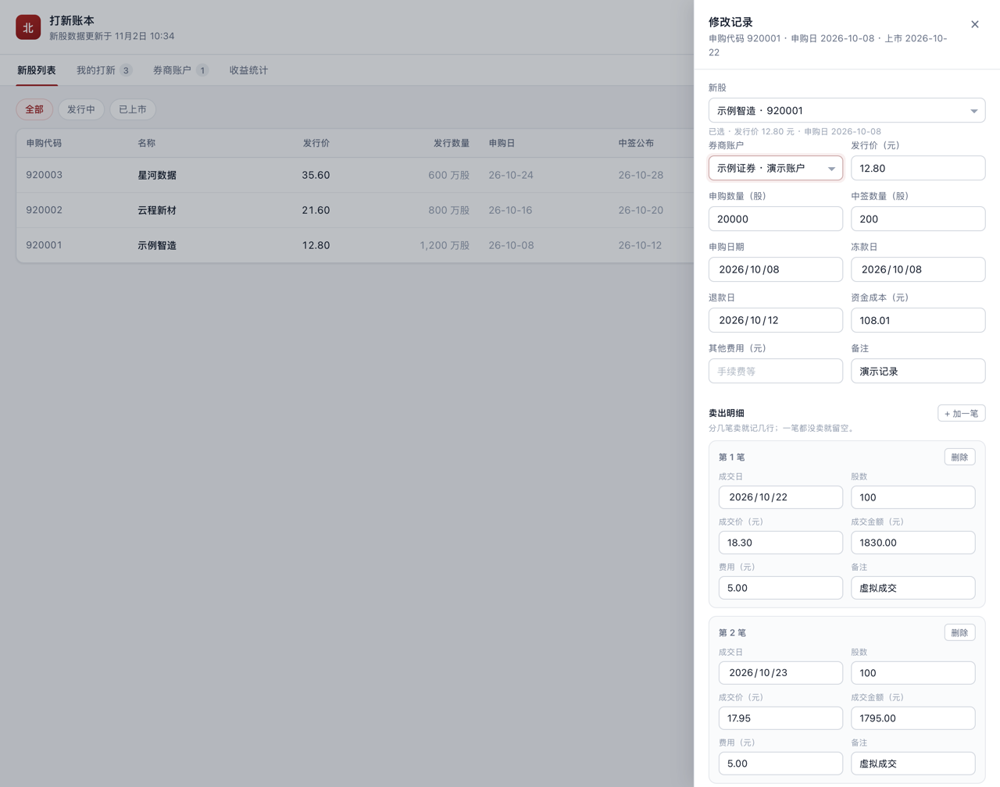
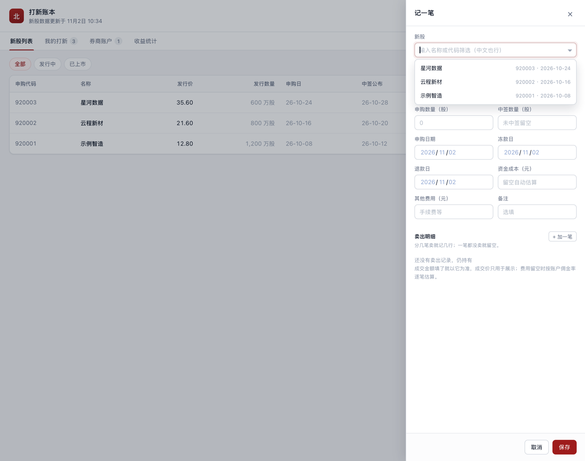
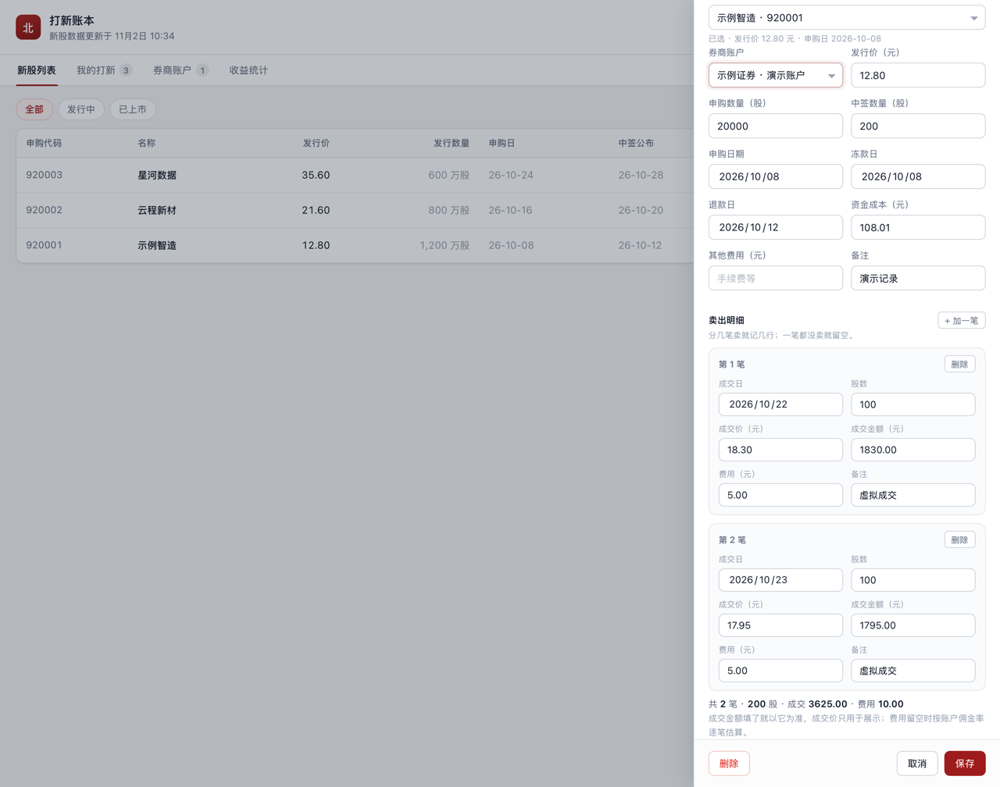
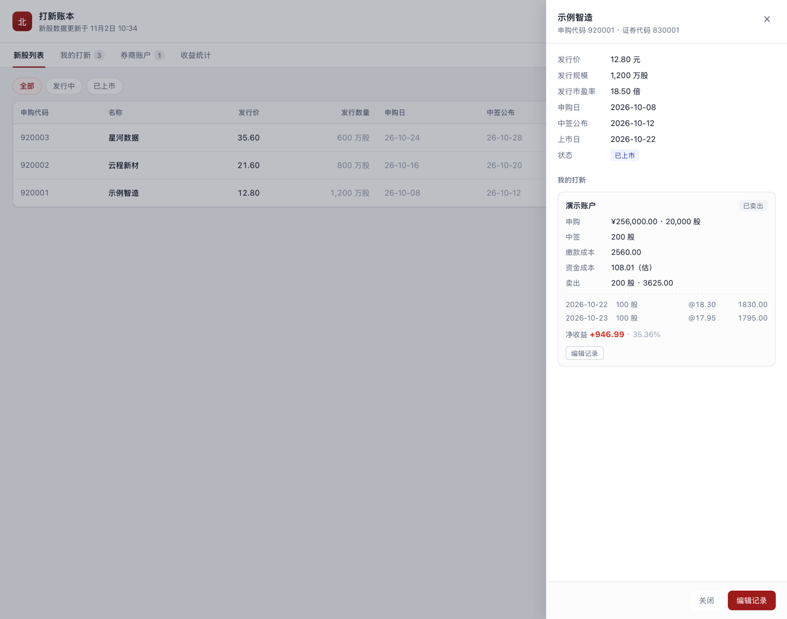
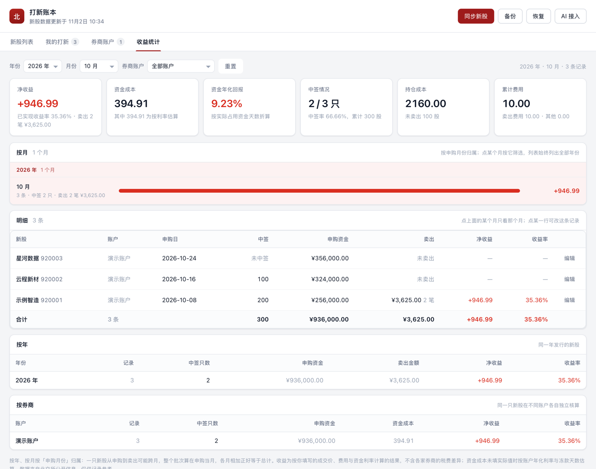
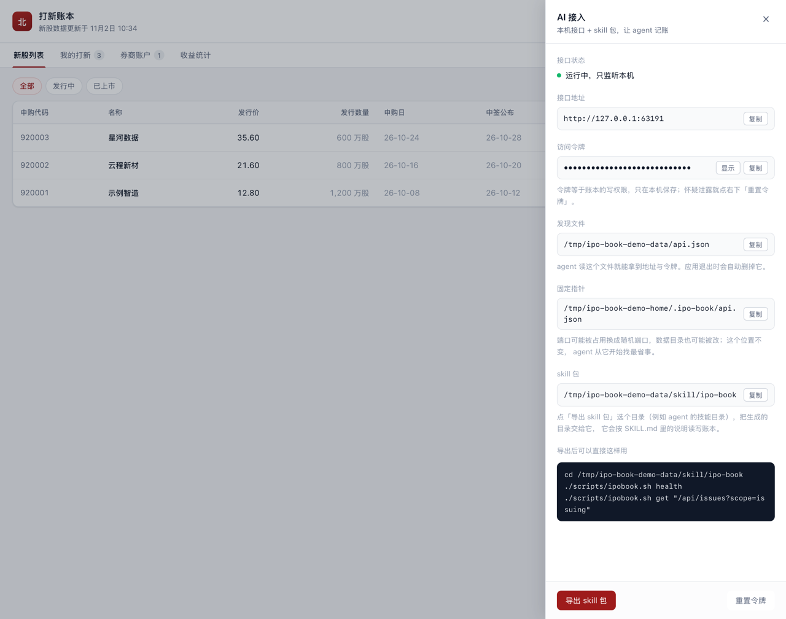

# 北交所打新账本

一台电脑上就能用的北交所打新账本。**双击图标打开**，账本存在本机，不上传任何数据。

新股列表直接取自北交所公开信息，主数据源不可用时自动切换到备用数据源，并在界面上
标注当前来源。


## 能做什么

- **看新股**：北交所正在发行和已上市的新股，含发行价、发行数量、申购日、中签公布日、上市日。
  点「查看」看发行细节（市盈率、证券代码）以及这只票在自己账上的申购、中签与逐笔卖出。
- **管账户**：券商账户单独维护，每家券商可以有多个账户，各自带佣金率、最低佣金和资金年化利率。
- **记一笔**：新股从列表里选（点开列全部，输入名称或代码实时筛选，中文也行），
  选中后自动带出申购代码、发行价与申购日；再选账户，填申购、中签、冻款起止、卖出与费用。
  记录列表里申购数量与申购金额（发行价 × 股数）并排显示，一眼看出这只票压了多少钱。
  排序跟着新股发行顺序走（按申购日，最近发行的在最上面），改一条记录不会让它跳到顶部。
- **卖出记多笔**：一只票分几次卖就记几行，每笔各有成交日、股数、成交价与费用，逐笔遵守最低佣金。
- **算成本**：按账户年化利率和冻款天数估算资金占用成本；卖出费用没填时按佣金率算，遵守最低佣金。
- **看收益**：净收益（已扣资金成本与全部费用）、收益率、资金年化回报，按年份、月份、
  券商账户筛选，并给出按月、按年、按券商的拆分。
- **备份恢复**：一键导出成文件，换电脑时导入即可继续用。
- **交给 AI**：内置只监听本机的接口和一份 skill 包，agent 可以自己记一笔、改中签、批量补录，
  界面跟着自动刷新。

| 券商账户 | 收益统计 |
| --- | --- |
|  |  |

| 打新记录 | 记账表单 |
| --- | --- |
|  |  |

新股只能从列表里选：点开列全部（按申购日倒序），输入名称或代码实时筛选，中文也能匹配片段。



一只票分几次卖，就按笔记录，每笔各算一次费用，合计由明细汇总：



新股列表里的「查看」看的是这只票本身：发行细节在前，自己在这个票上的申购、中签、
逐笔卖出在后，要改账再点「编辑记录」。



## 安装

macOS 上一条命令装进「应用程序」文件夹，之后从启动台、访达或 Dock 双击打开：

```bash
make install
```

也可以直接双击 `dist/darwin-universal/打新账本.app`，或把它拖进「应用程序」。程序是
签名过的通用二进制，Intel 与 Apple Silicon 都能跑，不需要装任何运行时。

其他平台：

| 平台 | 产物 |
| --- | --- |
| Windows | `打新账本.exe`，双击运行 |
| Linux | `app-<版本>-linux-amd64.tar.gz` 里的 `install.sh`，或 `app_<版本>_amd64.deb` |

Linux 上窗口使用系统自带的 WebKitGTK，若提示缺失，安装发行版对应的 `webkit2gtk` 即可。

## 新股数据从哪来

列表来自北交所公开的发行信息，读取的是官网页面自己用的那份数据：

| 顺序 | 来源 | 地址 |
| --- | --- | --- |
| 主 | 北交所官网 | `https://www.bse.cn` |
| 备用 | 北交所信息披露平台 | `https://www.bseinfo.net` |

两个来源由同一机构发布、字段一致。主源请求失败（超时、站点校验、空数据）时，程序
自动改用备用源，界面顶部会提示「已切换到备用数据源」，并说明数据可能有延迟。

站点对非浏览器请求有一道 cookie 校验：首次访问返回一段设置 `C3VK` cookie 的脚本。
程序会取出该 cookie 后重新请求，cookie 到期自动刷新，不需要手工干预。

数据只在点「同步新股」时拉取，之后存在本地，断网也能查看。列表默认保留最近约一年的
发行记录，便于补录以前打过的票。

## 资金成本怎么算

北交所打新要全额缴款，这笔钱在申购到退款之间是被占用的。账本把这部分成本算进收益：

```
资金成本 = 申购资金 × 账户年化利率 × 冻款天数 ÷ 365
申购资金 = 发行价 × 申购数量
冻款天数 = 退款日 − 冻款日（未填退款日时按 2 天估算）
```

- 在「券商账户」里给账户填年化利率，记账时就会自动估算。
- 想用实际数字（比如券商的融资利息），在记录里直接填「资金成本」，以实际值为准。
- 界面上估算出来的成本带一个 `估` 标记，与手工填写的实际值区分开。

卖出费用同理：**每笔**填了就按填的算；某笔没填就按账户佣金率算那笔的费用，并遵守最低佣金。
每条记录保存了当时的费率快照，之后改账户的费率不会影响历史账。

净收益 = 卖出收入 − 卖出部分缴款成本 − 资金成本 − 卖出费用 − 其他费用。
资金年化回报 = 净收益 ÷ 累计占用资金天数 × 365，用来比较不同账户的资金效率。

卖出收入按「成交金额」算：交割单给的是金额，多笔成交的均价常常除不尽（例如 300 股
卖了 8213.00 元，均价 27.3767 元）。某一笔填了成交金额就按金额，只填成交价才用
「股数 × 成交价」；记录上的成交金额、股数、均价与最后卖出日都由明细汇总得出，不单独存。

## 收益口径

- 单价以「分」为单位、数量以「股」为单位，金额由二者相乘得出，全程整数运算，不经过浮点数。
- 费率（佣金率、年化利率）以百万分之一为单位的整数保存：年化 3.85% = 38500，佣金万分之 2.5 = 250。
- 缴款成本 = 中签数量 × 中签价（未单独填写时等于发行价）。
- 未卖出的部分不计入已实现收益，只统计为持仓成本。

界面里的收益是按你填写的成交价、费用和利率算出来的结果，不含各家券商佣金与税费的差异，
也不构成投资建议。

## 收益统计

统计页把账本按年份、月份和券商账户切开来看，改一项筛选只重取统计，不重读整个账本。

- **筛选**：年份与月份按「申购日」算，券商账户按记录所属账户；三个条件可以叠用，
  右上角写着当前范围（例如「2026 年 10 月 · 平安证券 · 3 条记录」），点「重置」回到全部。
- **按月**：按年份分组，一行一个月，条长表示当月净收益的相对大小，右侧是金额。点一行
  直接按那个月筛选（年份与月份下拉跟着变），「这个月赚了多少、赚在哪几只票上」一步到位。
  这份列表是**按月翻账本**的入口，只跟券商账户走：选了 2026 年 10 月，2025 年、2024 年
  的每个月仍在列表里（选中的那个月会高亮并滚到可见处），想跨年份比一比不用先重置。
- **明细**：按月下面就是当前范围的每一条记录（新股、账户、申购日、中签、申购资金、卖出、
  净收益、收益率），逐行相加正好等于上面的合计与卡片。点某一行直接改那条记录，
  对不上账时不用再跳到「我的打新」去找。
- **按年 / 按券商**：各带合计行，净收益与总账逐分对齐；按券商看的是同一只新股在不同
  账户上各自独立核算的结果。
- **归属口径**：一只新股从申购到卖出可能跨月，整个批次都算在申购当月，所以各月、各年
  相加正好等于总计，不会因为跨月卖出被算两次。没填申购日的记录归到「未填申购日」，
  不进任何月份，也不进任何年份。


筛到 2026 年 10 月：卡片、明细、按年、按券商都只算这批记录，月度列表继续列出全部年份，
当前这一年与这个月高亮。



## 数据与备份

账本是一个 SQLite 文件（`ledger.db`），和程序放在同一数据目录：

- macOS：`~/Library/Application Support/bse-ipo-book/`
- Windows：`%AppData%\bse-ipo-book\`
- Linux：`~/.config/bse-ipo-book/`

同一目录里的 `app.log` 是运行日志，双击启动出问题时先看它——图形应用没有终端可看。

- 备份：界面右上角「备份」，选择保存位置，得到一份 JSON（含券商账户、记录与新股缓存）。
- 恢复：点「恢复」，再点一次确认，选择备份文件。**恢复会替换当前账本**，导入前建议先备份一次。
- 备份文件是明文 JSON，不要随意分享。

从旧版本升级不需要手动处理：打开时会自动补齐字段，历史上直接填在记录里的账户名会
被建成正式的券商账户，旧备份文件也仍然可以导入。

## 让 AI agent 记账

应用打开时会顺带启动一个**只监听本机**的接口，agent 与脚本通过它读写账本。界面右上角
「AI 接入」里能拿到接入信息，并把一份 skill 包导出给 agent。



- **接口地址**：默认 `http://127.0.0.1:47123`；端口被占用时改用随机端口，以发现文件为准。
- **发现文件**：数据目录下的 `api.json`，含地址、令牌与进程号，应用退出时自动删除。
- **固定指针**：`~/.ipo-book/api.json`，内容同上。端口可能是随机的、数据目录也可能被改，
  这个位置不变，agent 从它开始找。
- **访问令牌**：每次启动随机生成，写进数据目录下的 `api-token`（仅本人可读）。怀疑泄露就点「重置令牌」。

导出 skill 有三种方式，产物相同：

| 方式 | 用法 |
| --- | --- |
| 界面 | 「AI 接入」→「导出 skill 包」，选一个目录 |
| 命令行 | `打新账本 -export-skill <目录>`，不开窗口 |
| 接口 | `POST /api/skill/export`，body 为 `{"dir": "..."}` |

导出的目录可以直接放进 agent 的技能目录（例如 `~/.claude/skills/ipo-book`）：

```
SKILL.md              agent 该读的说明书：单位、常见流程、边界
references/api.md     接口与字段的完整说明
scripts/ipobook.sh    已配好地址与令牌的命令行客户端
```

脚本不需要再配任何东西：

```bash
./scripts/ipobook.sh doctor     # 看不到接口时先跑这个，它打印找过哪里、找到什么
./scripts/ipobook.sh health
./scripts/ipobook.sh get "/api/issues?scope=issuing"
./scripts/ipobook.sh post /api/entries '{"fxCode":"920306","applyShares":500,"issuePrice":"4.48"}'
```

本机若有 `HTTP_PROXY`，访问回环地址必须绕过代理，否则请求会被转发出去而失败
（脚本已带 `--noproxy '*'`）。

接口一览：

| 接口 | 用途 |
| --- | --- |
| `GET /api` | 列出全部接口与用法 |
| `GET /api/snapshot` | 一次拿到新股、账户、记录与汇总 |
| `GET /api/issues`、`POST /api/issues/refresh` | 查新股、同步新股 |
| `GET`/`POST /api/brokers`、`PATCH`/`DELETE /api/brokers/{id}` | 券商账户 |
| `GET`/`POST /api/entries`、`GET`/`PATCH`/`DELETE /api/entries/{id}` | 打新记录 |
| `POST /api/entries/{id}/sales` | 追加一笔卖出，agent 记「今天又卖了一笔」用它 |
| `PATCH`/`DELETE /api/entries/{id}/sales/{saleId}` | 改或删某一笔卖出 |
| `GET /api/summary` | 汇总与按账户统计 |
| `GET /api/stats` | 收益统计，支持 `year`、`month`、`brokerId`，附逐条明细与按年、按月拆分 |
| `GET /api/backup`、`POST /api/backup/restore` | 导出备份、恢复（须带 `?confirm=replace`） |
| `GET /api/skill`、`POST /api/skill/export` | skill 包 |

金额默认按「元」写（`"issuePrice": "4.48"`），也可以带 `Fen` 后缀直接给整数分
（`"issuePriceFen": 448`）；费率可用 `commissionWan`（万分之）、`annualRatePct`（%），
也可直接给 `commissionPpm` / `annualRatePpm`。`PATCH` 只改传了的字段。

卖出用 `sales` 数组整组提交，每笔 `{"date":"2026-10-28","shares":400,"price":"6.20"}`，
成交金额不填就按股数 × 成交价算：

```json
{"brokerId":1,"fxCode":"920306","allottedShares":1500,
 "sales":[{"date":"2026-10-28","shares":400,"price":"6.20"},
          {"date":"2026-10-30","shares":600,"amount":"3720.00","fee":"2.50"}]}
```

每笔明细都有自己的 `id`，改一笔、删一笔都按它定位；这个 ID 在重复保存时保持不变。
只记一笔卖出时也可以继续用老的写法（`soldShares`/`sellPrice`/`sellAmount`/`sellFee`/
`sellDate`），内部会折算成一笔明细；两种写法同时出现会报 400，不去猜本意。

agent 改完之后不用手动刷新：界面每 2.5 秒比对一次账本版本号，发现外部改动会自动重新载入。

## 目录结构

```
main.go                 启动窗口、绑定服务、本地接口、备份文件读写、日志
internal/source/        北交所新股数据源（主源 + 备用源，自动切换）
internal/store/         SQLite 存取、账户迁移与备份导入导出
internal/ledger/        领域模型：券商账户、记录、资金成本与收益核算
internal/httpapi/       给 agent 用的本地接口，含 skill 包模板
internal/api/           暴露给界面的服务
web/                    界面（HTML/CSS/JS，编译进二进制）
resources/icon.png      应用图标（打包时生成 .icns / .exe 图标）
mygo.json               应用名、标识与版本，打包时用
```

## 开发与测试

```bash
make test        # 单元测试，不访问网络
make test-live   # 访问真实北交所接口，验证主备两个来源
make test-ui     # 自截界面，确认打包进二进制的页面能渲染
make vet
make fmt
```

`internal/ledger` 的测试覆盖资金成本、佣金下限、冻款天数回退、多笔卖出汇总与逐笔校验；
`internal/store` 用临时数据库验证存取、账户唯一约束、旧库迁移、明细往返（含明细 ID 稳定）
和备份往返（含旧版备份）；`internal/source` 覆盖价格解析、日期解析与 JSONP 解析；
`internal/httpapi` 覆盖令牌鉴权、来源与 Host 校验、金额与费率换算、`PATCH` 局部更新、
明细的增删改、备份与 skill 导出。

打包由 MyGo 自带的打包器完成（`go tool mygo build`），它负责生成 `.app` 的 Info.plist、
从 PNG 生成 `.icns`、签名，以及 Windows 可执行文件与 Linux 桌面入口：

```bash
make app       # 只出 macOS 应用
make dmg       # macOS 应用 + 磁盘映像
make release   # 三个平台全量产物
```

从源码跑时用 `make build && ./bin/ipo-book`。全部命令行参数：

| 参数 | 用途 |
| --- | --- |
| `-data <目录>` | 指定数据目录，默认用系统用户数据目录 |
| `-api-addr <地址>` | 本地接口监听地址，默认 `127.0.0.1:47123` |
| `-no-api` | 不启动本地接口 |
| `-export-skill <目录>` | 导出 skill 包后退出，不开窗口 |
| `-version` | 打印版本号后退出 |
| `-capture <png>` / `-view <tab>` | 开发用：界面自截（`issues`/`entries`/`brokers`/`stats`/`ai`/`entry`，`entry/12` 打开某条记录，加 `/sales` 滚到卖出明细，`issue/920306` 打开某只新股的详情） |
| `-capture-height <像素>` | 开发用：截图时的窗口高度，抽屉内容较长时用，正式使用不需要 |
| `-capture-width <像素>` | 开发用：截图时的窗口宽度，用来检查最窄窗口下列表排版（默认 1180，最小 1040） |

双击启动时系统附带的 `-psn_0_xxxxx` 等参数会被忽略，不影响打开窗口。

## 说明

数据来自北交所公开信息，程序只读取、不提交，也不访问任何账户或交易接口。新股信息以
交易所公告为准，本账本用于个人记录。
