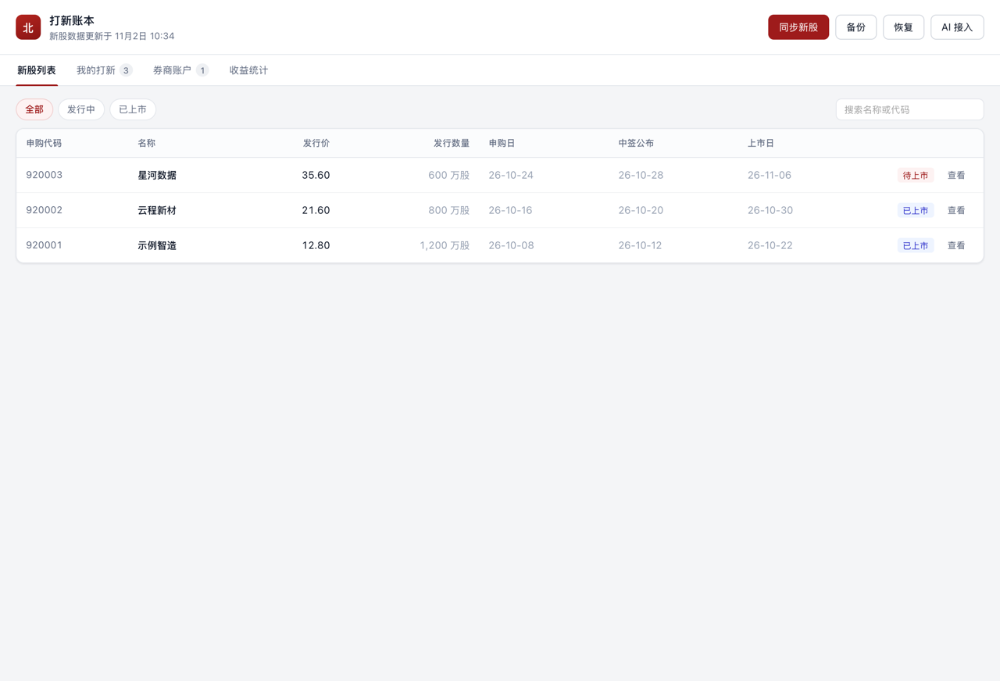
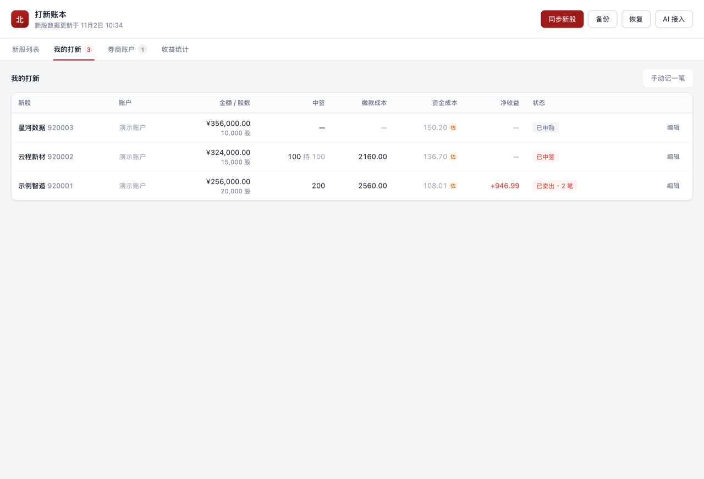
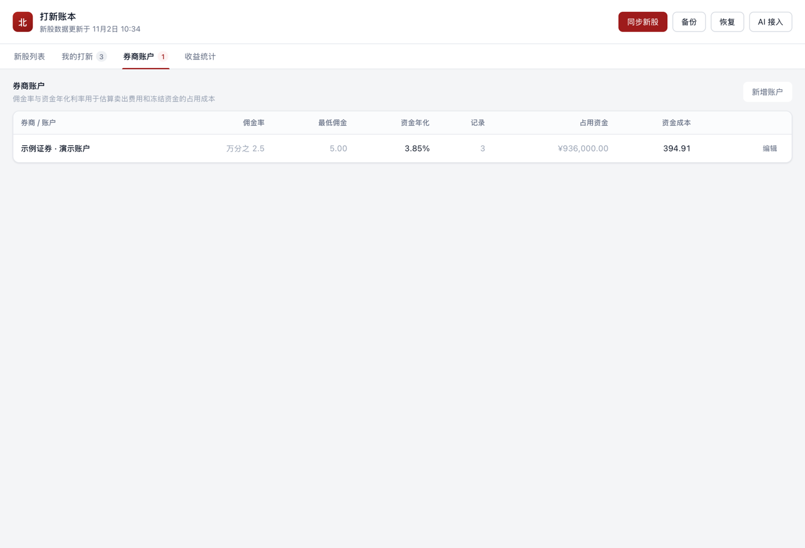
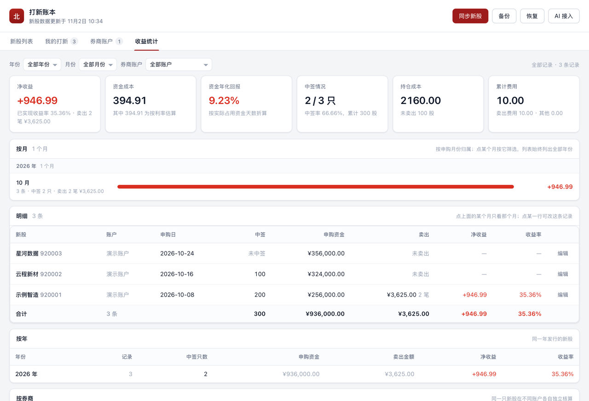

# 北交所打新账本

面向个人使用的本地桌面账本：记录北交所新股申购、中签、逐笔卖出与费用，并估算资金成本和收益。账本保存在本机，不上传个人记录。

## 界面截图

以下截图中的新股、券商账户、交易记录与收益均为虚拟示例数据。

| 新股列表 | 我的打新 |
| --- | --- |
|  |  |

| 券商账户 | 收益统计 |
| --- | --- |
|  |  |

## 功能

- 查看北交所新股发行信息、申购日、中签公布日和上市日。
- 按券商账户记录申购、中签、冻款区间及多笔卖出；费率可按账户设置。
- 汇总已实现收益、持仓成本、资金成本，并按申购年月和券商账户统计。
- 导出、恢复本地 JSON 备份；恢复会替换当前账本，操作前请先备份。
- 可选的本机 AI 接口与 skill 包，供本机 agent 读写账本。

## 下载与安装

从 [GitHub Releases](../../releases/latest) 下载对应平台的安装包：

| 平台 | 安装方式 |
| --- | --- |
| macOS | 下载通用版 `.dmg`，将「打新账本.app」拖入「应用程序」；也可从源码运行 `make install`。 |
| Windows | 推荐下载对应架构的 Setup 安装向导，按提示安装；也可下载 ZIP 解压后运行。安装向导按当前用户安装，通常不需要管理员权限。 |
| Linux | 下载对应架构的 `.deb` 或 `.tar.gz`。窗口依赖系统 WebKitGTK；缺少时安装发行版提供的 WebKitGTK。 |

Windows 版本目前未配置代码签名，首次下载或运行时可能出现 SmartScreen 提示；安装向导不会自动消除该提示。

## 数据来源与隐私

发行信息来自北交所官方公开信息：

- 主来源：<https://www.bse.cn>
- 备用来源：<https://www.bseinfo.net>

应用仅为读取新股发行信息而访问以上来源；不访问券商账户或交易接口，也不与其他网站交换账本数据。账本、备份和本机接口凭据保存在本地。AI 接口只监听本机回环地址。

数据以交易所公告为准。应用不会提交申购或交易指令。

## 记账与收益口径

- 金额按整数分计算，费率用整数保存；页面输入和展示时再换算。
- 缴款成本按中签数量 × 中签价计算；未单独填写中签价时使用发行价。
- 未填退款日时，资金成本按冻款 2 天估算；手工填写资金成本时以填写值为准。
- 未填卖出费用时按账户佣金率估算，并遵守最低佣金；估算费用与实际填写费用有区分。
- 净收益只统计已卖出的部分；未卖出部分计入持仓成本。统计按申购日归属月份和年份。
- 收益是基于填写数据的估算，不含所有券商实际费用差异，也不构成投资建议。费用未知不等于零。

## 数据与备份

默认数据目录：

- macOS：`~/Library/Application Support/bse-ipo-book/`
- Windows：`%AppData%\bse-ipo-book\`
- Linux：`~/.config/bse-ipo-book/`（遵循 `XDG_CONFIG_HOME`）

账本数据库为 `ledger.db`。可在应用中导出 JSON 备份；备份包含个人账本内容，请妥善保存，不要公开分享。恢复备份会整体替换当前账本。

## 本机 AI 接入

应用提供仅在本机可访问的 HTTP JSON 接口。打开「AI 接入」可查看接口地址、访问令牌与发现文件，并导出 skill 包。令牌具有账本写入权限，不要分享。

本机接口包括新股、券商账户、打新记录、统计与备份等功能。完整接口说明见 `internal/httpapi/templates/references/api.md`；agent 使用说明见 `internal/httpapi/templates/SKILL.md`。

## 从源码构建

需要 Go 与 MyGo 构建工具。常用命令：

```bash
make test        # 单元测试，不访问外部网络
make app         # 构建 macOS 通用版应用
make install     # 构建并安装到「应用程序」文件夹
make release     # 生成 macOS、Windows 与 Linux 各架构的发布产物
```

`make test-live` 会访问北交所主、备用数据源，验证在线取数；其他单元测试使用本地测试数据。

## 开发结构

```text
internal/source/   北交所发行信息读取
internal/ledger/   账务模型、收益与统计口径
internal/store/    SQLite 存储、迁移与备份
internal/api/      界面和本机接口共用的业务服务
internal/httpapi/  本机 HTTP API 与 agent skill 模板
web/               桌面界面
```
